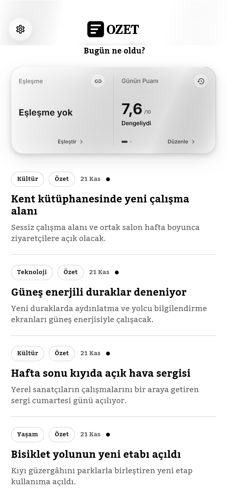
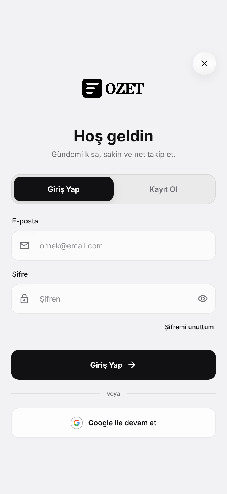
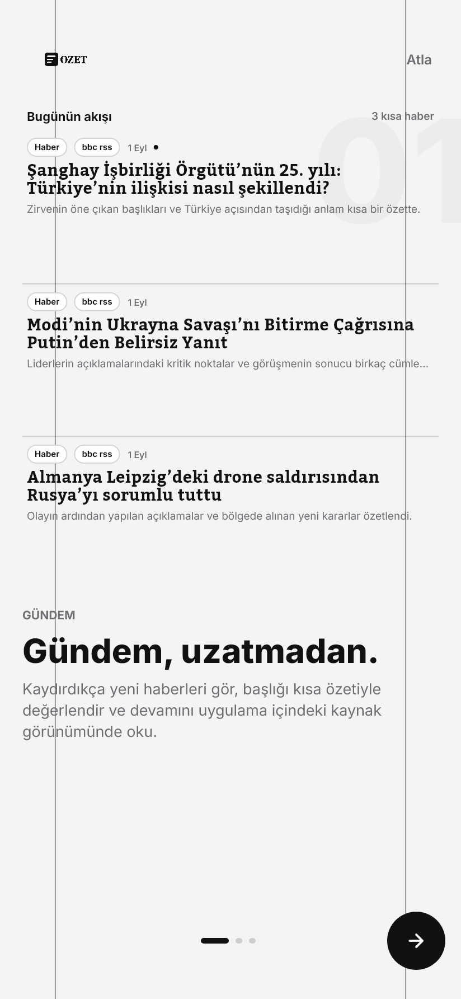
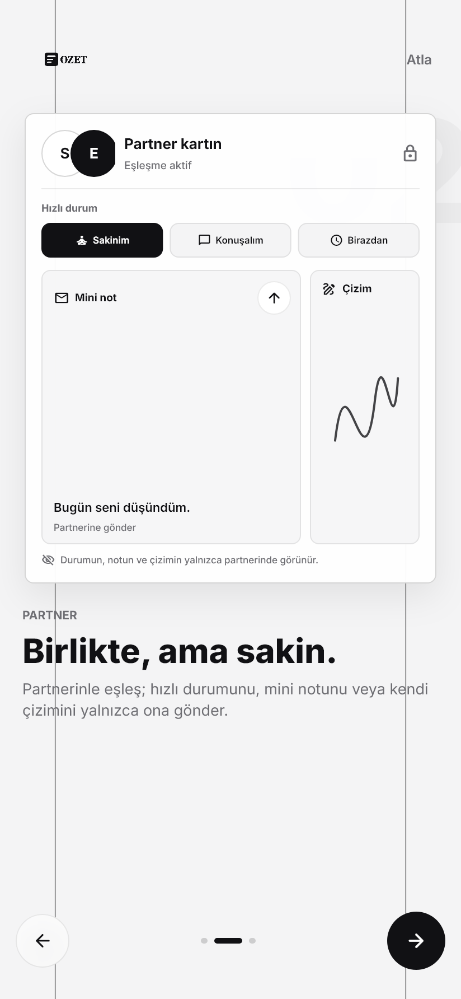
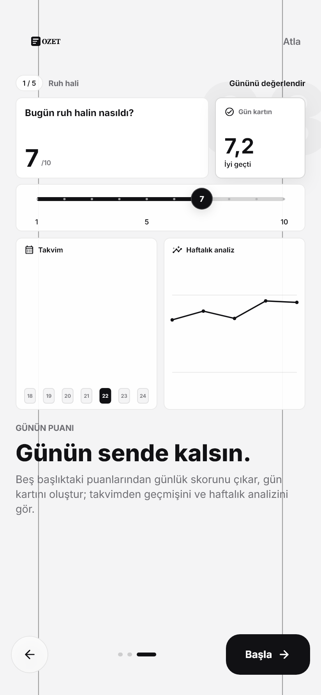
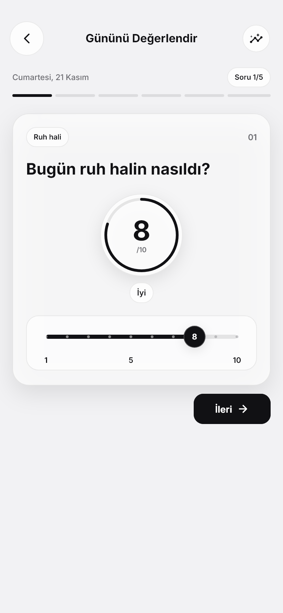
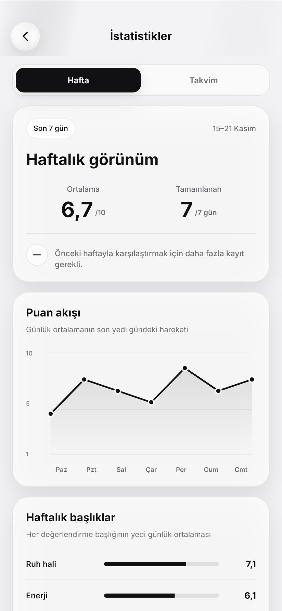
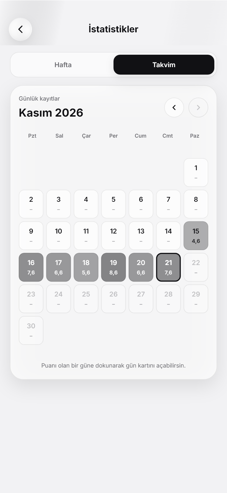

# Özet

Özet, gündemi kısa haber özetleriyle takip edebileceğin bir Flutter uygulamasıdır.
Haber akışı, RSS kaynakları ve yayın süreci Firebase tabanlı bir web panelinden yönetilir.

## Mobil uygulama

- **Haber akışı:** Kısa özetlere göz at, haber ayrıntılarını aç ve orijinal kaynağı uygulama içinde oku.
- **Partner:** Eşleştiğin kişiyle kısa durum, mini not ve çizim paylaş.
- **Günün Puanı:** Gününü beş başlıkta değerlendir, not ekle ve önceki kayıtlarını takvimden veya haftalık istatistiklerden incele.
- **İlk kullanım:** Haberler, Partner ve Günün Puanı özelliklerini örneklerle tanı.

### Ekran görüntüleri

Görseller Özet mobil uygulamasının güncel Flutter ekranlarından telefon boyutunda oluşturuldu. Haber akışında ve Günün Puanı geçmişinde örnek kayıtlar kullanıldı.

**Ana ekran ve giriş**

<p>
  <a href="docs/screenshots/09-ana-ekran.png"></a>
  <a href="docs/screenshots/08-giris.png"></a>
</p>

**İlk kullanım**

<p>
  <a href="docs/screenshots/01-onboarding-haberler.png"></a>
  <a href="docs/screenshots/02-onboarding-partner.png"></a>
  <a href="docs/screenshots/03-onboarding-gunun-puani.png"></a>
</p>

**Günün Puanı**

<p>
  <a href="docs/screenshots/04-gununu-degerlendir.png"></a>
  <a href="docs/screenshots/06-haftalik-istatistik.png"></a>
  <a href="docs/screenshots/07-takvim.png"></a>
</p>

[Gün kartı ayrıntısı](docs/screenshots/05-gun-karti.png)

## Yönetim paneli

Panelde RSS kaynakları ve manuel taslaklar yönetilir. Taslaklar yapay zekâyla özetlenebilir, kategorileri düzenlenebilir ve tek tek veya toplu olarak yayına alınabilir. Yayındaki içerikler ve yayın istatistikleri de aynı panelden takip edilir.

## Yerel geliştirme

Mobil uygulama için Dart 3.11 veya üstünü içeren bir Flutter SDK ve bağlı bir cihaz ya da emülatör gerekir. Proje kökünde aşağıdaki komutları çalıştır.

```sh
flutter pub get
flutter run
```

Yönetim panelinin web arayüzünü yerelde sunmak için Firebase CLI ile aşağıdaki komutları çalıştır. Giriş, Firestore ve Cloud Functions, panelde yapılandırılmış Firebase projesini kullanır. Bu projede yapılan yayın, silme ve bildirim işlemleri gerçek veriyi etkiler.

```sh
cd ozet-admin-panel
firebase emulators:start --only hosting
```

Mobil kodu doğrulamak için proje kökünde `flutter analyze` ve `flutter test` çalıştır. Panelin statik testleri için `ozet-admin-panel` klasöründe `npm run test:static` komutunu kullan.

[Geliştirme notları](docs/gelistirme_notlari.md) · [Android yayın hazırlığı](docs/release_hazirlik.md)
